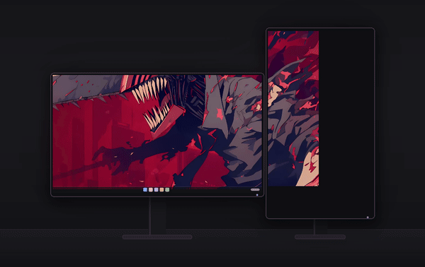

<p align="center">
  <picture>
    <source media="(prefers-color-scheme: dark)" srcset="assets/readme/logo-dark.png">
    
  </picture>
</p>

<p align="center">
  <b>One wallpaper. Every monitor. Lined up like a single window onto your desk.</b><br>
  Live MP4 and still-image wallpapers for Windows.
</p>

<p align="center">
  <a href="https://github.com/craigrusselltiu/multipapr/releases/latest"></a>
  
  
</p>

---

Windows spans wallpapers by **pixels**, which breaks scale and alignment across mixed monitors and bezels. Multipapr maps by **physical size** instead, so the image continues cleanly from one screen to the next.

<table>
  <tr>
    <th>Multipapr</th>
    <th>Live Displays</th>
  </tr>
  <tr>
    <td></td>
    <td></td>
  </tr>
</table>

## Install

Download [`multipapr.exe`](https://github.com/craigrusselltiu/multipapr/releases/latest/download/multipapr.exe) and run it, or run one command in PowerShell to install it with a Start menu entry:

```powershell
irm https://raw.githubusercontent.com/craigrusselltiu/multipapr/main/install.ps1 | iex
```

## Goal

<p align="center">
  <picture>
    <source media="(prefers-color-scheme: dark)" srcset="assets/readme/diagram-dark.png">
    
  </picture>
</p>

The problem Multipapr tries to solve is the visible jump where a wallpaper crosses from one monitor to the next. A circle split across two screens should still look like one circle.

## Features

<table>
  <tr><td><b>Multi-mode</b></td><td>Give each display its own wallpaper setup.</td></tr>
  <tr><td><b>Profiles</b></td><td>Save wallpaper setups to switch between them later.</td></tr>
  <tr><td><b>Gallery</b></td><td>Browse still and animated wallpapers from a large source collection.</td></tr>
  <tr><td><b>Lock axis</b></td><td>Hold <kbd>Ctrl</kbd> for horizontal, <kbd>Ctrl</kbd>+<kbd>Shift</kbd> for vertical.</td></tr>
  <tr><td><b>Tray</b></td><td>Click to reopen. Right-click → <b>Close</b> to stop the wallpaper.</td></tr>
</table>

## Playback

> [!NOTE]
> Playback uses [mpv](https://mpv.io/), which is built into the exe and unpacked once on first use.

Multipapr decodes a shared video once, using the GPU when possible. Still images render once and then idle.

## CLI

```powershell
multipapr.exe --apply "D:\Wallpapers\loop.mp4"
multipapr.exe --background
multipapr.exe --stop
multipapr.exe --displays
```

Settings, previews and logs live in `%LOCALAPPDATA%\Multipapr`.

<details>
<summary><b>Build from source</b></summary>

```powershell
git clone https://github.com/craigrusselltiu/multipapr
cd multipapr
cargo test --release --locked
.\install.ps1 -FromSource
```

</details>

<details>
<summary><b>Known limits</b></summary>

- Multipapr places its wallpaper window behind the desktop icons using a part of Explorer that Windows doesn't document, so a future Windows update could break it.
- If a monitor reports no physical size, Multipapr assumes 96 DPI. You can correct it under **Advanced**.
- Screens in Windows' **Duplicate** mode show the same pixels, so the wallpaper is sized for the first screen on that output.

</details>

## License

[MIT](LICENSE). The release exe bundles [mpv](https://mpv.io/), which is GPL-licensed. See [third-party notices](THIRD-PARTY-NOTICES.md).
