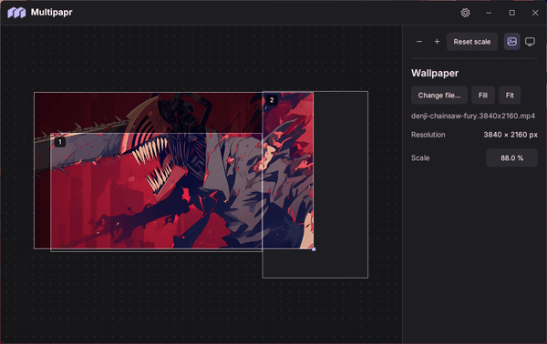
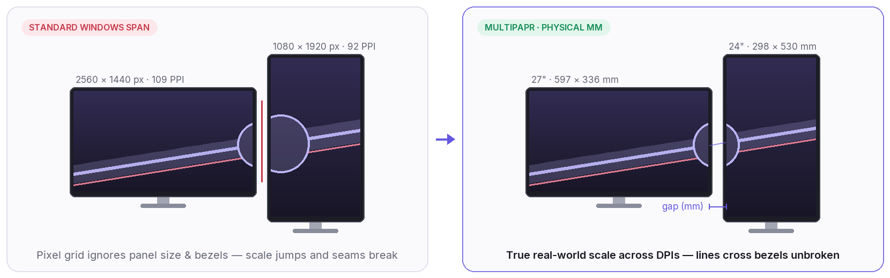

<p align="center">
  <picture>
    <source media="(prefers-color-scheme: dark)" srcset="assets/readme/logo-dark.png">
    
  </picture>
</p>

<p align="center">
  <b>One wallpaper. Every monitor. Lined up like a single window onto your desk.</b><br>
  Live MP4 and still-image wallpapers for Windows, mapped in real millimetres across mixed monitors.
</p>

<p align="center">
  <a href="https://github.com/craigrusselltiu/multipapr/releases/latest"></a>
  
  
</p>

---

Windows spans a wallpaper by **pixels**. Put a 27" 1440p screen beside a 24" 1080p screen and the image changes size at the seam, skips over the bezels and drifts out of line. Multipapr maps it by **physical size** instead, so a line that leaves one monitor comes out of the next one at the right height and scale.

<table>
  <tr>
    <th>Multipapr</th>
    <th>Displays</th>
  </tr>
  <tr>
    <td></td>
    <td></td>
  </tr>
</table>

<sub>Left: a recording of the editor. Right: the same frames played on a 27" 1440p landscape monitor and a 24" 1080p portrait monitor.</sub>

## Install

**Download:** grab [`multipapr.exe`](https://github.com/craigrusselltiu/multipapr/releases/latest/download/multipapr.exe) and run it. There's nothing else to install.

**Or run one command** in PowerShell to install it with a Start menu entry:

```powershell
irm https://raw.githubusercontent.com/craigrusselltiu/multipapr/main/install.ps1 | iex
```

## Summary

<p align="center">
  <picture>
    <source media="(prefers-color-scheme: dark)" srcset="assets/readme/diagram-dark.png">
    
  </picture>
</p>

> [!TIP]
> **Measure once.** Multipapr reads each panel's size from the monitor. Drag a display to where it actually sits, or type the gap in millimetres under **Advanced**. Include both bezels and any air gap.

1. **Choose a file:** an MP4, MOV, MKV or WebM video, or a PNG, JPEG, WebP or BMP image. You can also drop it onto the canvas.
2. **Frame it.** Drag the wallpaper to move it and drag its corner to resize it. **Fill** shows it at native size, so a 4K image appears twice the size of a 1080p panel. **Fit** covers every display. **Upscaling** picks the resampling filter: Catmull-Rom by default, or None, Spline36, Lanczos or EWA Lanczos Sharp. Sharper filters cost more GPU time.
3. **Line up the displays.** Use the monitor tool to drag each display into place. The wallpaper on your desktop updates as you drag.
4. **Close the window.** The wallpaper keeps playing from the tray and starts again when you sign in.

<table>
  <tr><td><b>Pan / zoom</b></td><td>Drag empty canvas or middle-drag. Scroll to zoom. <b>Reset scale</b> reframes.</td></tr>
  <tr><td><b>Lock an axis</b></td><td>Hold <kbd>Ctrl</kbd> to drag horizontally, <kbd>Ctrl</kbd>+<kbd>Shift</kbd> for vertically.</td></tr>
  <tr><td><b>Tray</b></td><td>Click to reopen the editor. Right-click → <b>Close</b> to stop the wallpaper.</td></tr>
  <tr><td><b>Startup</b></td><td>Toggle <b>Start at sign-in</b> from the settings cog.</td></tr>
</table>

## Lightweight

> [!NOTE]
> Playback uses [mpv](https://mpv.io/), which is built into the exe and unpacked once on first use.
>
> A single mpv instance decodes the video once, on the GPU where possible, and one shader maps it to every display. Audio, interpolation and network caching are off. Playback **pauses** when the desktop is locked or a fullscreen window covers it, and it recovers after Explorer restarts or displays change. A still image renders once and then stays idle.

## Command line

```powershell
multipapr.exe --apply "D:\Wallpapers\loop.mp4"   # fit a file to your displays and start it
multipapr.exe --background                        # start in the tray
multipapr.exe --stop                              # stop the wallpaper and quit
multipapr.exe --displays                          # print detected displays as JSON
```

Settings, previews and logs live in `%LOCALAPPDATA%\Multipapr`.

<details>
<summary><b>Build from source</b></summary>

```powershell
git clone https://github.com/craigrusselltiu/multipapr
cd multipapr
cargo test --release --locked
.\install.ps1 -FromSource
```

</details>

<details>
<summary><b>Known limits</b></summary>

- Multipapr places its wallpaper window behind the desktop icons using a part of Explorer that Windows doesn't document, so a future Windows update could break it.
- If a monitor reports no physical size, Multipapr assumes 96 DPI. You can correct it under **Advanced**.

</details>

## License

[MIT](LICENSE). The release exe bundles [mpv](https://mpv.io/), which is GPL-licensed. See [third-party notices](THIRD-PARTY-NOTICES.md).
