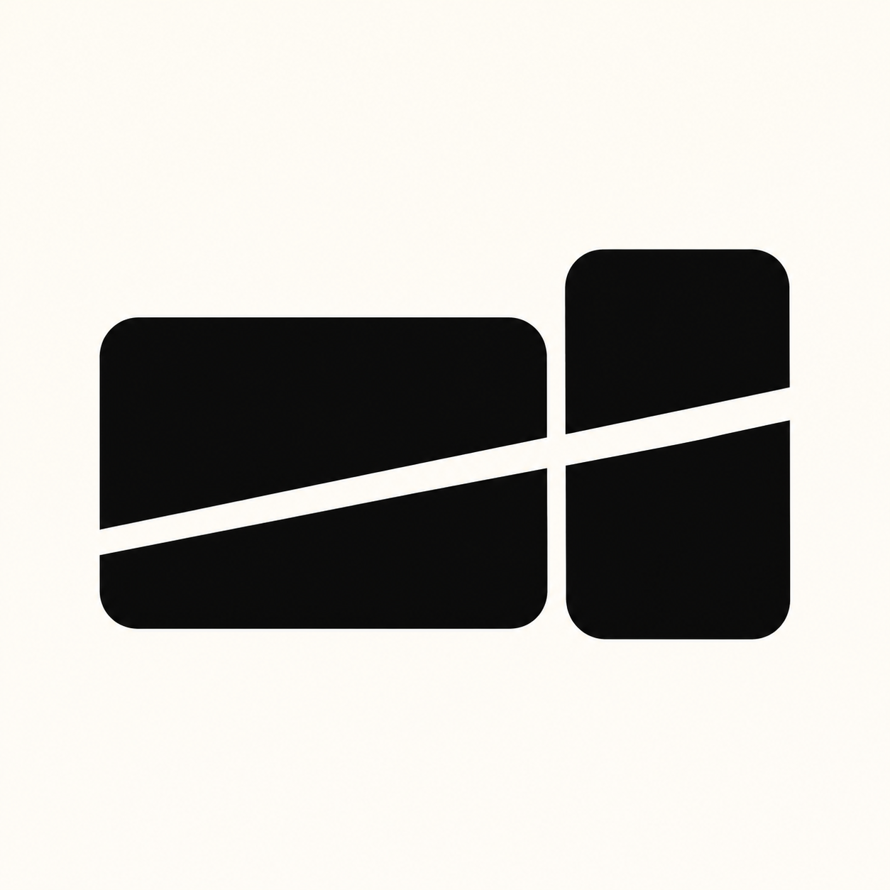
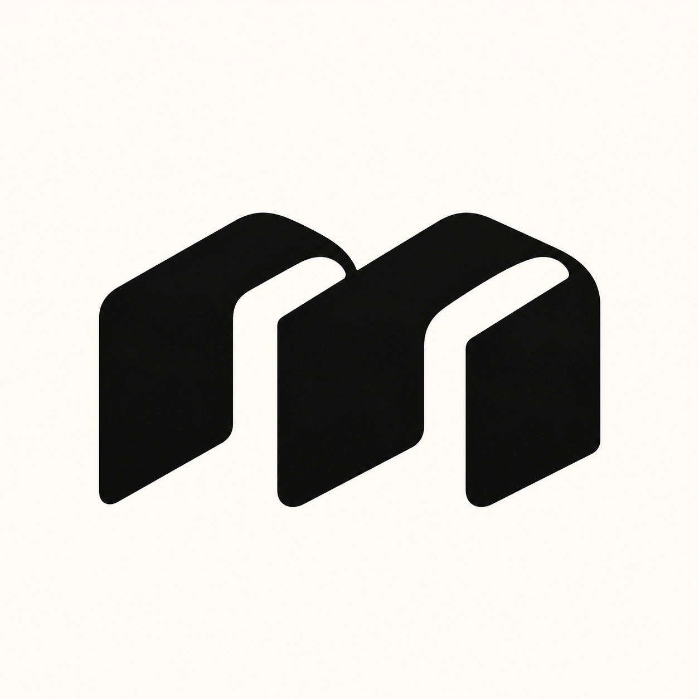
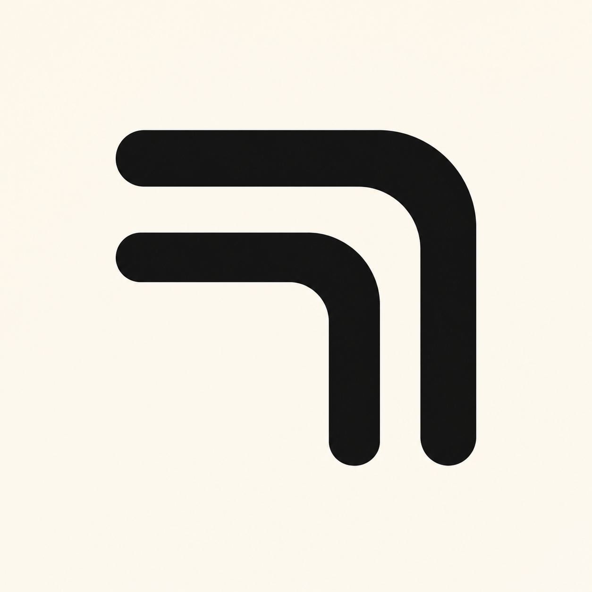

# Multipapr logo concepts

Seam is the selected app and system tray icon.

| Seam | Fold | Ripple |
| --- | --- | --- |
|  |  |  |

Image generation prompts

Generated with the built-in image generator.

**Seam**

Use case: logo-brand. Generate a single minimalist app symbol for Multipapr, a multi-display wallpaper editor. A single broad diagonal cut through two aligned ink-black panes, one wide and one tall, so the eye follows one horizon across a gap. Flat solid near-black on plain ivory, centered in a square, generous padding. Bold enough for a 16px system tray. No letters or wordmark, no labels, no shadows, no gradients, no mockups.

**Fold**

Use case: logo-brand. Generate a single minimalist app symbol for Multipapr, a multi-display wallpaper editor. A single folded sheet of paper forming an abstract lowercase m from three broad planes defined by one continuous black silhouette and white negative space. No separate frame. Flat solid near-black on plain ivory, centered in a square, generous padding. Bold enough for a 16px system tray. No letters or wordmark, no labels, no shadows, no gradients, no mockups.

**Ripple**

Use case: logo-brand. Generate a single minimalist app symbol for Multipapr, a multi-display wallpaper editor. Two nested offset rounded right-angle contours, like a sheet echoing outward. Bold open-ended strokes, compact, abstract and pleasantly asymmetric. Flat solid near-black on plain ivory, centered in a square, generous padding. Bold enough for a 16px system tray. No letters or wordmark, no labels, no shadows, no gradients, no mockups.

